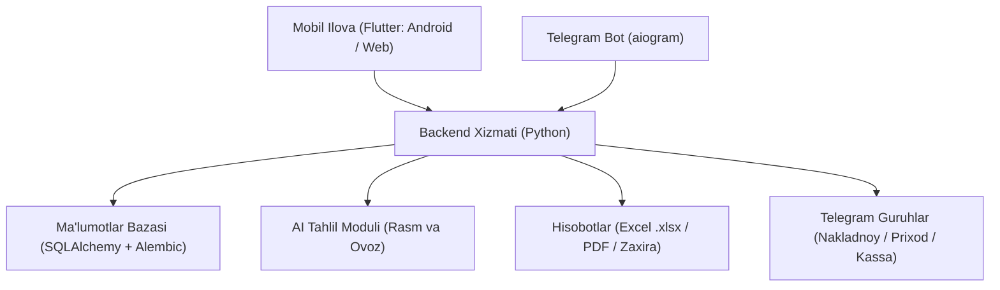

# Hisobchi — Kassa, Nakladnoy va Hisobot Tizimi

> **Joriy ilova versiyasi:** `v1.0.48`  
> **Platformalar:** Android (Play Market `.aab` va to'g'ridan-to'g'ri `.apk`), Telegram Web Mini App (Flutter Web), Telegram Bot (Python / `aiogram`), Ma'lumotlar bazasi (SQLite / PostgreSQL).

**Hisobchi** — do'kon va savdo nuqtalari uchun kunlik naqd pul aylanmasi, ta'minotchi (postavshik) nakladnoylari, nasiya/qarz nazorati, kassa sverkasi, YesPOS prixod (ITOG) tahlili va Excel/PDF hisobotlarini yagona ekotizimda boshqaruvchi tizim.

---

## Asosiy Imkoniyatlar

| Yo'nalish | Nimalarni bajaradi |
| :--- | :--- |
| **Kunlik Kassa va Smena** | Kechadan qoldiq, `Pul oldim`, `Pul oldimni qaytarish`, `Kassa qarzi (olish / qaytarish)`, `Xarajat` va smena yopish balansini avtomatik hisoblaydi. |
| **Nakladnoy va To'lovlar** | Naqd, Karta, O'tkazma (perechesleniya) va Qarzga nakladnoylar, qisman to'lov, rasm biriktirish, guruhga yuborish va tahrirlash. |
| **Kassa Sverkasi** | Kun davomida qo'ldagi naqd pulni o'zgartirmaydigan **oraliq (vaqtinchalik)** sverkalar (vaqt, sanalgan pul, farq) hamda kun yopishdagi **asosiy** sverka tarixi. |
| **Ta'minotchilar va Nasiya** | Postavshiklar reyestri, sinxron qidiruv (lotin/kirill o'xshash nomlar), qarzlar nazorati, jonli sverka va PDF akt-sverka. |
| **AI Hujjat va Ovoz** | Nakladnoy rasmidan postavshik, summa va qatorlar tekshiruvini avtomatik o'qish; ovozli buyruqlar orqali tez kirim/chiqim kiritish. |
| **Hisobotlar va Prixod (ITOG)** | Kunlik, 7 kunlik, oylik, ixtiyoriy davr va sverka bo'yicha formatlangan Excel (`.xlsx`), PDF akt-sverka hamda YesPOS prixod jadvali tahlili. |
| **Oflayn Rejim va Duplikat Himoyasi** | Internetsiz holatda ma'lumotlarni lokal navbatda saqlash, aloqa tiklanganda avtomatik sinxronlash va takroriy yuborishlarga qarshi himoya. |

---

## Tizim Arxitekturasi



---

## Kassa Hisob-Kitob Formulasi

Har bir smena (kun) uchun qo'lda qolishi kerak bo'lgan naqd pul quyidagi qoidalar asosida avtomatik hisoblanadi:

- **Jami kirim (qo'ldagi manba):**  
  `Kechadan qoldiq + Pul oldim − Pul oldimdan qaytarilgan + Kassadan qarz − Kassaga qaytarilgan`
- **Qo'lda qolishi kerak (Naqd):**  
  `Jami kirim − Naqd nakladnoylar − Boshqa xarajatlar`
- **Karta, O'tkazma va Qarzga nakladnoylar** qo'ldagi naqd puldan ayrilmaydi — alohida hisobda yuritiladi.
- **Pul oldimdan qaytarilgan** (`main_return`) — asl `Pul oldim` yozuvini o'chirmasdan qo'ldagi balansdan ayiradi, `Xarajat`ga aralashmaydi va `Kassa qarzi` qoldig'iga ta'sir qilmaydi.

---

## Loyiha Tuzilmasi (Qayerda Nima Borligi)

```text
Hisobot_bot_and_integratsiya_yespos/
├── main.py                         # Asosiy ishga tushirish nuqtasi (Bot + Backend + Scheduler)
├── config.py                       # Ilova konfiguratsiya yuklovchisi
├── requirements.txt                # Python kutubxonalari ro'yxati
├── Dockerfile                      # Konteyner yig'ish ko'rsatmasi
├── docker-compose.yml              # Konteyner orkestratsiyasi
├── alembic.ini                     # Baza migratsiyalari sozlamasi
├── alembic/
│   ├── env.py                      # Alembic muhiti
│   └── versions/                   # Baza sxemasi migratsiyalari (0001..0004)
│
├── database/                       # Ma'lumotlar bazasi qatlami
│   ├── models.py                   # Jadvallar (Smena, Kassa, Sverka, Nakladnoy, Qarz, Prixod va b.)
│   ├── crud.py                     # Barcha hisob-kitob, balans, tarix va CRUD funksiyalari
│   ├── session.py                  # Asinxron baza ulanishi va ishga tushirish
│   └── sync_state.py               # Jonli sinxronizatsiya versiyasi (revision) holati
│
├── api/                            # Mobil va Web ilova bilan ishlovchi backend moduli
│   ├── app.py                      # So'rovlarni qayta ishlash, idempotency va biznes logikasi
│   ├── auth.py                     # Sessiya, rol, rate-limit va autentifikatsiya tekshiruvlari
│   ├── deps.py                     # Telegram guruh sinxronizatsiyasi, rasm saqlash va blokirovkalar
│   └── schemas.py                  # Ma'lumot validatsiya modellari (Pydantic)
│
├── bot/                            # Telegram Bot qatlami
│   ├── auth.py                     # Foydalanuvchi rollari va kirish huquqlari
│   ├── keyboards.py                # Tugmalar (Reply va Inline klaviaturalar)
│   ├── states.py                   # Suhbat holatlari (FSM)
│   ├── storage.py                  # FSM holat xotirasi
│   └── handlers/                   # Bot buyruqlari va bo'limlar
│       ├── wallet_nakladnoy.py     # Kassa, pul oldi-berdi, nakladnoy va kun yopish
│       ├── nasiya.py               # Postavshik nasiya va qarz hisobi
│       ├── prixod_itog.py          # YesPOS prixod (ITOG) tahlili va yuborish
│       ├── settings_groups.py      # Guruhlar, arxiv, sverka va bot sozlamalari
│       ├── admin_tools.py          # Administrator vositalari va zaxira
│       ├── apk_link.py             # Ilova ulash va kirish kodi berish
│       └── navigation.py           # Asosiy menyu va navigatsiya
│
├── services/                       # Tashqi va yordamchi servislar
│   ├── excel_export.py             # Formatlangan Excel hisobotlar (kunlik, davr, sverka, prixod)
│   ├── pdf_sverka.py               # Postavshiklar uchun PDF akt-sverka generatori
│   ├── gemini_ai.py                # Rasm (nakladnoy) va ovozli buyruqlar AI tahlili
│   ├── prixod_parser.py            # YesPOS jadval va matnli ITOG parseri
│   ├── yespos_client.py            # YesPOS integratsiya yordamchisi
│   ├── backup.py                   # Ma'lumotlar bazasi zaxira nusxasi
│   └── scheduler.py                # Rejali avtomatik vazifalar
│
├── scripts/
│   └── restore_backup.py           # Zaxira nusxadan tiklash skripti
│
├── tests/
│   └── test_all.py                 # Backend, hisob-kitob, Excel, AI va duplikatga qarshi testlar
│
├── build_aab.ps1                   # Play Market (.aab) yig'ish skripti
├── build_apk.ps1                   # Android (.apk) yig'ish skripti
├── build_web.ps1                   # Flutter Web Mini App yig'ish skripti
│
└── mobile/                         # Flutter Mobil va Web Ilova
    ├── pubspec.yaml                # Flutter paketlari va joriy versiya
    ├── assets/app_icon.png         # Ilova logotipi
    ├── android/                    # Android konfiguratsiya (play/direct flavor, ProGuard, Keystore)
    ├── web/                        # Web Mini App shabloni va ikonkalari
    ├── lib/
    │   ├── main.dart               # Asosiy ekranlar, navigatsiya, dialoglar va Sozlamalar oynasi
    │   ├── widgets.dart            # Hero karta, pastki docked menyu, analitika, top-bildirishnomalar
    │   ├── widgets_3d.dart         # 3D splash, kubik va kirish animatsiyalari
    │   ├── theme.dart              # Yorug' va Tungi (Obsidian) dizayn tokenlari
    │   ├── api_client.dart         # Backend bilan bog'lanish va lokal kesh
    │   ├── offline_sync.dart       # Oflayn navbat (outbox), idempotency va server bilan solishtirish
    │   ├── security.dart           # Salted SHA-256 PIN xesh, urinish blokirovkasi va HTTPS nazorati
    │   ├── custom_camera.dart      # Hujjat skaneri, qiyalik ko'rsatkichi va ko'p sahifali yopishtirish
    │   ├── platform_bridge*.dart   # Android (Keystore/Biometrika/Fayl) va Web ko'prigi
    │   └── version.dart            # Ilova versiya konstantasi
    └── test/
        └── widget_test.dart        # Flutter UI, xavfsizlik va oflayn-sinxronizatsiya testlari
```

---

## Mobil Ilova Bo'limlari

- **Header (Tepa panel):**
  - Ilova belgisi, versiya va jonli sinxronizatsiya nuqtasi (yashil = onlayn avto-yangilanish faol, sariq = oflayn).
  - **Ovozli buyruq (`🎤`)**, **Mavzu (`☀️/🌙`)** va **Sozlamalar (`⚙️`)**.
  - Qo'lda yangilash tugmasi olib tashlangan — barcha bo'limlar fon rejimida va tab almashtirganda avtomatik yangilanadi.
- **Pastki menyu (Chekkaga birlashtirilgan 4 ta bo'lim):**
  1. **Dashboard** — Asosiy balans kartasi (`Pul oldim` [Olish / Qaytarish], `Kassa` [Qarz olish / Qaytarish], `Xarajat`), xarajatlar taqsimoti, davriy grafiklar va kassa amallari lentasi.
  2. **Amallar** — Kunlik nakladnoylar ro'yxati, tezkor **`Sverka`** va **`Arxiv`** tugmalari, filtrlar, qidiruv va tezkor swipe amallari.
  3. **Ta'minotchilar** — Postavshiklar profili, qarzlar/nasiyalar, qisman yoki to'liq yopish va PDF akt-sverka.
  4. **Smena** — Kassa sverka (oraliq va asosiy), kupyura kalkulyatori, smena yopish, Excel hisobotlar va Prixod (ITOG).
- **Sozlamalar (`⚙️`):** Tungi mavzu, Postavshik sozlamalari, Xavfsizlik (PIN va Otpechatka), Telegram guruh/xodimlar va hisob boshqaruvi.
- **Yagona bildirishnomalar:** Ilovadagi barcha xabarlar (saqlash, tahrirlash, o'chirish + `Bekor qilish`, xatolar) tepadan pastga yumshoq tushadi va ustiga bosilganda tez yopiladi.

---

## Xavfsizlik Tamoyillari

> [!IMPORTANT]
> Maxfiy ma'lumotlar (muhit o'zgaruvchilari, tokenlar, kalitlar, server manzillari va imzolash fayllari) repozitoriyga **qo'shilmaydi** — ular `.gitignore` orqali qat'iy ajratilgan.

- **Ma'lumotlarni himoyalash:** Android qurilmalarda sessiya ma'lumotlari **Android Keystore (AES-256-GCM)** orqali shifrlanadi; tizim avto-zaxiralash (`allowBackup`) o'chirilgan.
- **Kirish nazorati:** 4 xonali PIN kod tasodifiy tuz (salt) bilan **SHA-256** ko'rinishida saqlanadi, ketma-ket xato urinishlarda vaqtinchalik blokirovka ishlaydi; kirish/PIN ekranlarida skrinshotga qarshi (`FLAG_SECURE`) himoya yoqilgan.
- **Tarmoq va Kod himoyasi:** Faqat shifrlangan **HTTPS** ulanishga ruxsat beriladi; Android chiqarish yig'malarida **R8** va **Dart obfuskatsiyasi** yoqilgan.
- **Play Market talablari:** `play` va `direct` build variantlari ajratilgan (`play` versiyasida ortiqcha paket o'rnatish ruxsatlari olib tashlangan).
- **Duplikatga qarshi himoya:** Har bir moliyaviy amal yagona `idempotency` kaliti, foydalanuvchi bo'yicha navbat blokirovkasi va oflayn→onlayn qayta tekshiruv orqali ikki marta yozilishidan himoyalangan.

---

## Tekshirish va Testlar

Mahalliy muhitda kod sifatini va avtomatik testlarni tekshirish:

```powershell
# Backend testlari (40 ta test)
python -m pytest -q

# Mobil ilova statik tahlili va testlari (34 ta test)
cd mobile
flutter analyze
flutter test
```

> [!NOTE]
> Loyihani ishga tushirish uchun muhit sozlamalarini shaxsiy lokal konfiguratsiya faylida (`.env.example` namunasiga qarab) to'ldiring va maxfiy kalitlarni hech qachon Gitga qo'shmang.
